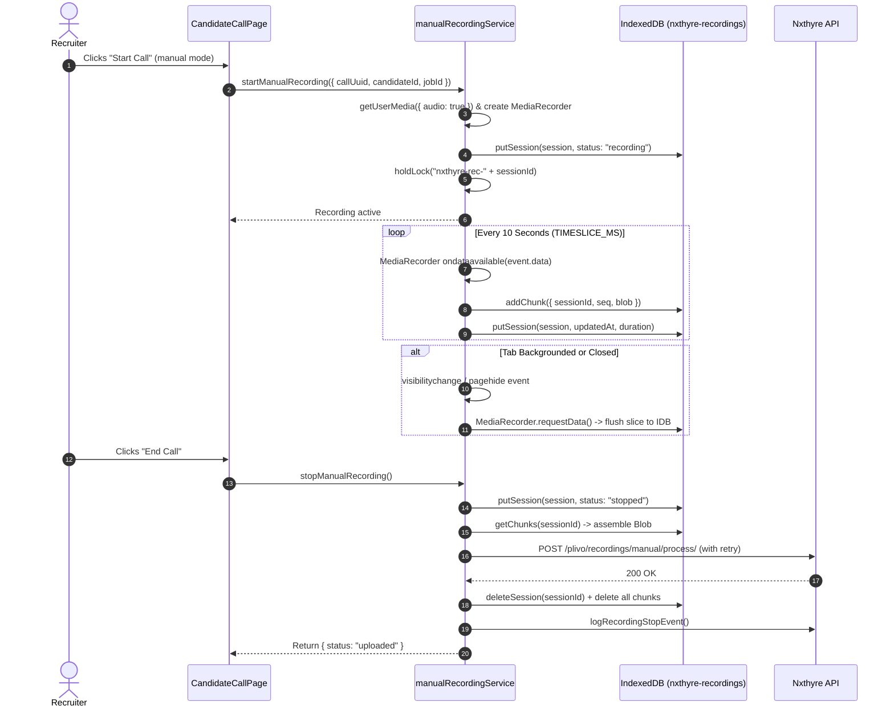
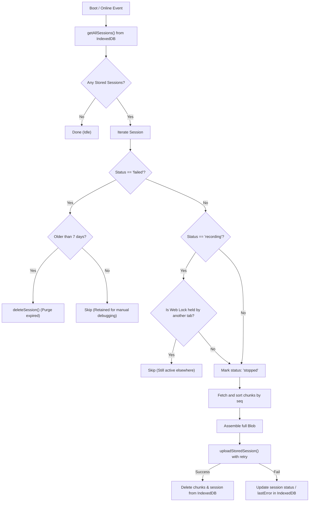

# IndexedDB Manual Call Recording Specification

This document provides a comprehensive technical overview and reference for the **client-side IndexedDB persistence and recovery architecture** used for manual call audio recordings.

- **Primary Implementation File**: [`src/services/manualRecordingService.ts`](file:///c:/Users/rohit/OneDrive/Desktop/nxthyre-frontend-vite/src/services/manualRecordingService.ts)
- **Primary UI Consumer**: [`src/pages/companies/components/candidate-call-page/CandidateCallPage.tsx`](file:///c:/Users/rohit/OneDrive/Desktop/nxthyre-frontend-vite/src/pages/companies/components/candidate-call-page/CandidateCallPage.tsx)
- **Reactive Hook**: [`src/hooks/useManualRecordingState.ts`](file:///c:/Users/rohit/OneDrive/Desktop/nxthyre-frontend-vite/src/hooks/useManualRecordingState.ts)
- **Boot Lifecycle Initializer**: [`src/main.tsx`](file:///c:/Users/rohit/OneDrive/Desktop/nxthyre-frontend-vite/src/main.tsx)

---

## 1. Architectural Motivation & Problem Statement

### The Problem
During manual recruiter-candidate phone screening calls, recruiter microphone audio is captured in-browser via the `MediaRecorder` API. Previously, audio was buffered purely in React component state / in-memory closures:
- A page reload, browser crash, accidental navigation, or tab close would terminate the component lifecycle and immediately destroy in-flight recordings.
- Network dropouts or transient HTTP 5xx errors during upload would permanently drop the entire interview audio.
- Heavy audio bitrates could exceed Cloud Run's 32 MB request body limit on long calls.

### The Solution: Modular Durable Persistence
The recording lifecycle is owned by a singleton service running **outside the React component tree**, backed by **IndexedDB**:
1. **Periodic Time-slicing**: Audio is captured and committed to IndexedDB every 10 seconds (`TIMESLICE_MS = 10_000`). At most 10 seconds of audio could ever be lost in a catastrophic hardware or OS crash.
2. **Page & Tab Visibility Guards**: In-memory audio buffers are forcefully flushed to IndexedDB whenever the tab is hidden (`visibilitychange`) or navigating away (`pagehide`).
3. **Automatic Recovery**: On application launch (`main.tsx`) or network reconnection (`online`), the service queries IndexedDB for abandoned recordings and uploads them automatically.
4. **Cross-Tab Safety**: Web Locks API (`navigator.locks`) prevents multiple browser tabs from creating race conditions or duplicate uploads.
5. **Bandwidth Optimization**: Audio is captured at 32 kbps Opus (~0.24 MB/min), providing over 2 hours of recording capacity under the 32 MB Cloud Run upload limit.

---

## 2. IndexedDB Schema & Storage Design

- **Database Name**: `nxthyre-recordings`
- **Database Version**: `1`

The database contains two object stores:

```
┌─────────────────────────────────────────────────────────────┐
│                 IndexedDB: nxthyre-recordings               │
├──────────────────────────────┬──────────────────────────────┤
│      ObjectStore: sessions   │     ObjectStore: chunks      │
│     (KeyPath: "sessionId")   │    (Key: autoIncrement)      │
│                              │  Index: "sessionId" (foreign)│
└──────────────────────────────┴──────────────────────────────┘
```

### 2.1 Store: `sessions`
Tracks recording metadata, duration, parent IDs, and upload status.

- **Primary Key**: `sessionId` (UUID string)
- **Record Structure (`StoredSession`)**:

| Field | Type | Description |
| :--- | :--- | :--- |
| `sessionId` | `string` | Unique session identifier generated at recording start. |
| `callUuid` | `string` | Call UUID associated with the candidate call session. |
| `candidateId` | `string` | Candidate identifier. |
| `jobId` | `string` | Job ID associated with the screening round. |
| `callerUid` | `string?` | Firebase Auth UID of the recruiter conducting the call. |
| `mimeType` | `string` | Audio MIME type (e.g. `audio/webm;codecs=opus`). |
| `startedAt` | `number` | Unix timestamp (epoch ms) when recording commenced. |
| `updatedAt` | `number` | Unix timestamp of last chunk or state write. |
| `durationSec` | `number` | Total active recorded duration (excluding pause periods). |
| `status` | `string` | `"recording"` \| `"stopped"` \| `"failed"` |
| `stopLogged` | `boolean`| Flag ensuring `logRecordingStopEvent` is called exactly once. |
| `lastError` | `string?` | Last error message if upload failed. |

#### Session Status State Machine
- `"recording"`: Audio is actively streaming or session crashed mid-call without explicit stop.
- `"stopped"`: Call was cleanly stopped or tab closed; audio is compiled and awaiting/attempting upload.
- `"failed"`: Upload failed permanently (e.g. invalid IDs / HTTP 400). Kept for 7 days (`FAILED_SESSION_TTL_MS`) for manual recovery before cleanup.

---

### 2.2 Store: `chunks`
Contains the raw binary audio slices appended incrementally.

- **Primary Key**: Auto-incremented integer
- **Indexes**: `sessionId` (points to `sessions.sessionId`)
- **Record Structure (`StoredChunk`)**:

| Field | Type | Description |
| :--- | :--- | :--- |
| `sessionId` | `string` | Foreign key referencing `sessions.sessionId`. |
| `seq` | `number` | 0-indexed sequential counter for audio slice ordering. |
| `blob` | `Blob` | Binary chunk captured by `MediaRecorder.ondataavailable`. |

---

## 3. Recording & Persistence Lifecycle



### 3.1 Start Phase (`startManualRecording`)
1. Verifies that no other recording is active in the current tab.
2. Acquires mic stream via `navigator.mediaDevices.getUserMedia({ audio: true })`.
3. Chooses supported MIME format in order of preference:
   - `audio/webm;codecs=opus`
   - `audio/webm`
   - `audio/ogg;codecs=opus`
   - `audio/mp4`
4. Initializes `ActiveSession` state and starts `MediaRecorder` with `timeslice = 10_000` ms.
5. Writes the initial `StoredSession` record into IndexedDB `sessions` store with status `"recording"`.
6. Requests a Web Lock `nxthyre-rec-${sessionId}` to prevent other tabs from attempting recovery while this tab is actively recording.

### 3.2 Streaming Phase
1. Every 10 seconds, `recorder.ondataavailable` triggers with an audio `Blob`.
2. Appends in-memory and enqueues an asynchronous write to the serial `writeQueue`:
   - Adds the `StoredChunk` row to the `chunks` store.
   - Updates `durationSec` and `updatedAt` on the `sessions` row.
3. If an IndexedDB write fails (quota exceeded, private browsing restrictions), the session sets `persistFailed = true` but **does not break audio recording**—in-memory audio remains intact for normal stop.

### 3.3 Pause & Resume Phase
- `pauseManualRecording()`: calls `recorder.pause()`, accumulates active milliseconds, and emits state update.
- `resumeManualRecording()`: calls `recorder.resume()`, updates timestamp, and continues slicing.

### 3.4 Stop & Finalize Phase (`stopManualRecording`)
1. Calls `recorder.stop()`.
2. Shuts down all microphone audio tracks.
3. Waits for any pending IndexedDB writes in `writeQueue` to settle.
4. Marks session as `"stopped"` in the `sessions` store.
5. Reconstructs the complete audio `Blob` from chunks.
6. Delegates to `uploadStoredSession`:
   - Size check: Must exceed `MIN_RECORDING_BYTES` (4096 bytes).
   - Uploads via multipart FormData to `${API_BASE}/plivo/recordings/manual/process/`.
   - On success: cleans up session and all associated chunks from IndexedDB, and sends `logRecordingStopEvent`.
   - On failure: preserves chunks in IndexedDB with updated `lastError` and status `"stopped"` (or `"failed"` if permanent).
7. Releases the Web Lock.

---

## 4. Multi-Tab Concurrency & Cross-Tab Locking

To prevent race conditions across multiple open browser windows/tabs, the service leverages the **Web Locks API** (`navigator.locks`):

1. **Recording Lock (`nxthyre-rec-${sessionId}`)**:
   - Held by the active recording tab from `startManualRecording` until `finalize`.
   - When another tab launches or checks for recovery, it queries `navigator.locks.query()`. If the recording lock is held, that session is skipped.
2. **Upload Lock (`nxthyre-upload-${sessionId}`)**:
   - Acquired with `{ ifAvailable: true }` before executing `uploadWithRetry`.
   - If two tabs attempt recovery simultaneously on reconnect, only the first tab acquires the lock; the second tab defers (`{ status: "deferred" }`), eliminating duplicate uploads.

---

## 5. Crash Recovery & Offline Re-sync Mechanism

Recovery is orchestrated by `recoverPendingRecordings()` and `initManualRecording()`:

### 5.1 Trigger Events
`initManualRecording()` registers three automatic listeners:
1. **App Mount (`main.tsx`)**: When user logs in or reloads the tab (`onAuthStateChanged`).
2. **Network Online (`window.online`)**: When network connectivity is restored.
3. **Storage Persistence**: Requests persistent storage via `navigator.storage?.persist?.()`.

### 5.2 Recovery Workflow (`doRecover()`)


---

## 6. Upload Specifications & Retry Strategy

### 6.1 Backend API Contract
- **Endpoint**: `POST /api/plivo/recordings/manual/process/`
- **Content-Type**: `multipart/form-data`
- **Headers**: `Authorization: Bearer <token>` (refreshed via `getFreshAuthToken()`)

#### Form Fields Sent
| Field | Type | Description |
| :--- | :--- | :--- |
| `call_uuid` | `string` | Session Call UUID. |
| `candidate_id` | `string` | Candidate identifier. |
| `job_id` | `string` | Job post identifier. |
| `caller_uid` | `string?` | Firebase User UID (optional). |
| `recording_duration`| `string` | Total active call duration in integer seconds. |
| `audio` | `File / Blob` | Audio binary file named `${callUuid}.${ext}` (e.g. `.webm`, `.ogg`, `.m4a`). |

### 6.2 Retry Backoff
Uploads retry on transient errors with progressive delays:
```ts
const RETRY_DELAYS_MS = [0, 2_000, 5_000, 15_000, 30_000];
```
- Total retry duration: ~52 seconds across 5 attempts.
- HTTP `400` or `413` responses throw `PermanentUploadError` (aborting immediate retry to prevent spamming server).

---

## 7. Frontend Integration Reference

### 7.1 How `CandidateCallPage.tsx` Consumes the Service

```tsx
import {
  startManualRecording,
  stopManualRecording,
  pauseManualRecording,
  resumeManualRecording,
  updateManualRecordingContext,
  waitForPendingUploads,
} from "../../../../services/manualRecordingService";
import { useManualRecordingState } from "../../../../hooks/useManualRecordingState";

// 1. Reactive state hook
const recordingState = useManualRecordingState();
const isSavingRecording = recordingState.pendingUploads > 0;

// 2. Starting a manual call
const handleStartManualCall = async () => {
  const newUuid = callUuid || crypto.randomUUID();
  setCallUuid(newUuid);
  setManualCallConnected(true);
  
  await startVoiceRecording(newUuid);
};

// 3. Ending a call
const handleEndManualCall = async () => {
  setManualCallConnected(false);
  await stopVoiceRecording();
};

// 4. Guaranteed upload completion before page unmount / modal redirects
await waitForPendingUploads();
```

---

## 8. PostHog Telemetry Events

The service logs telemetry to PostHog for end-to-end visibility:

| Event Name | Properties Tracked | Description |
| :--- | :--- | :--- |
| `recording_started` | `callUuid`, `mimeType` | MediaRecorder successfully started. |
| `recording_stop_requested` | `callUuid` | Recruiter triggered stop. |
| `recording_upload_started` | `callUuid`, `sessionId`, `bytes` | Multi-part upload began. |
| `recording_upload_succeeded`| `callUuid`, `sessionId`, `bytes` | Upload succeeded and IndexedDB cleaned. |
| `recording_upload_failed` | `callUuid`, `permanent`, `error` | Upload failed after retries. |
| `recording_recovery_attempt`| `callUuid`, `sessionId`, `bytes` | Abandoned recording detected and queued. |
| `recording_persist_failed` | `callUuid`, `error` | IndexedDB write failure (e.g. storage quota). |
| `recording_too_small` | `callUuid`, `bytes` | Recording below 4KB minimum threshold. |

---

## 9. Developer Inspection & Debugging Guide

To verify or debug IndexedDB state in browser Developer Tools:

1. Open Chrome / Edge DevTools (**F12**).
2. Navigate to the **Application** tab.
3. In the left sidebar, expand **Storage** -> **IndexedDB** -> **`nxthyre-recordings - http://...`**.
4. Inspect the two stores:
   - **`sessions`**: Check `durationSec`, `status`, and `lastError`.
   - **`chunks`**: Verify `seq` increments every 10 seconds while recording audio.
5. To test recovery:
   - Start a call, speak into mic for 20 seconds.
   - Force-close the tab or disconnect network in DevTools.
   - Reopen the app: observe in Console that `recoverPendingRecordings()` initiates and uploads the stored chunks.
